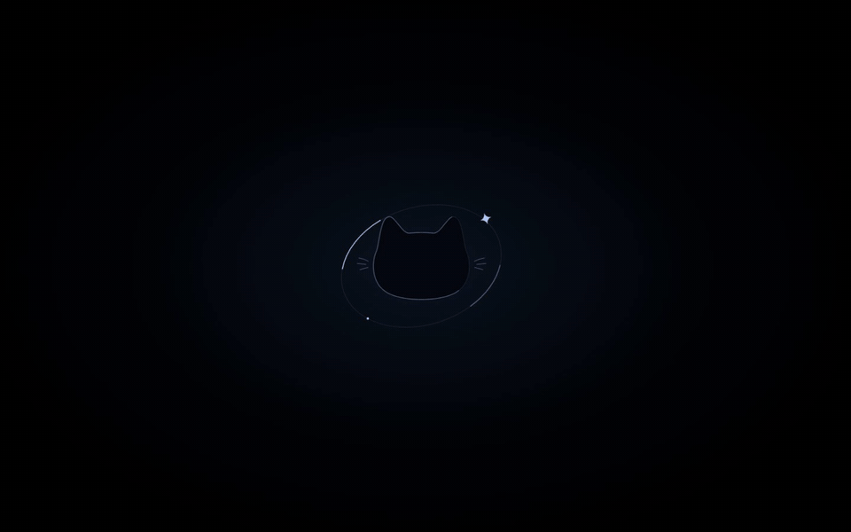
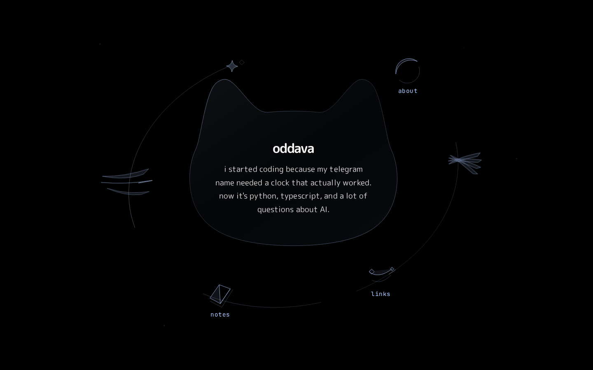
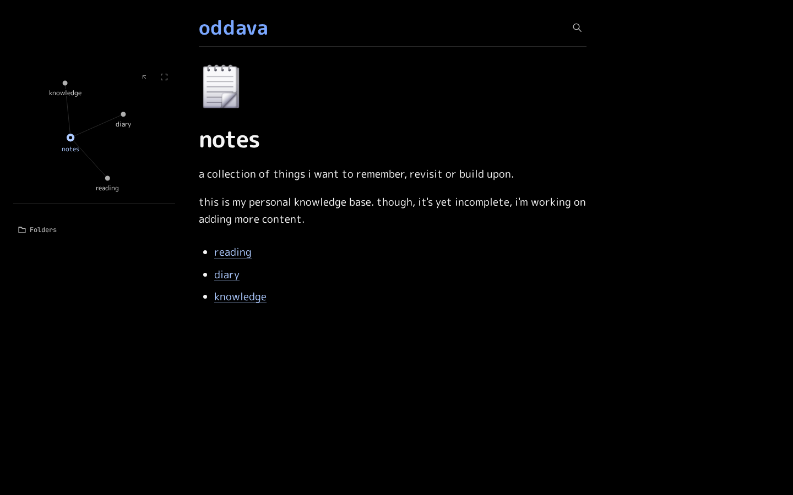
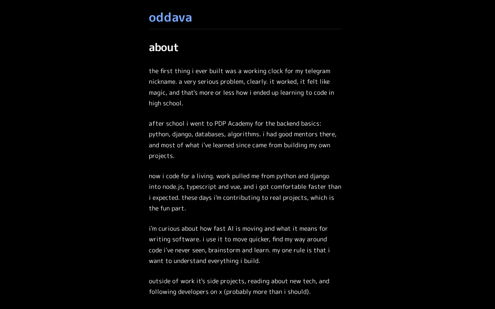
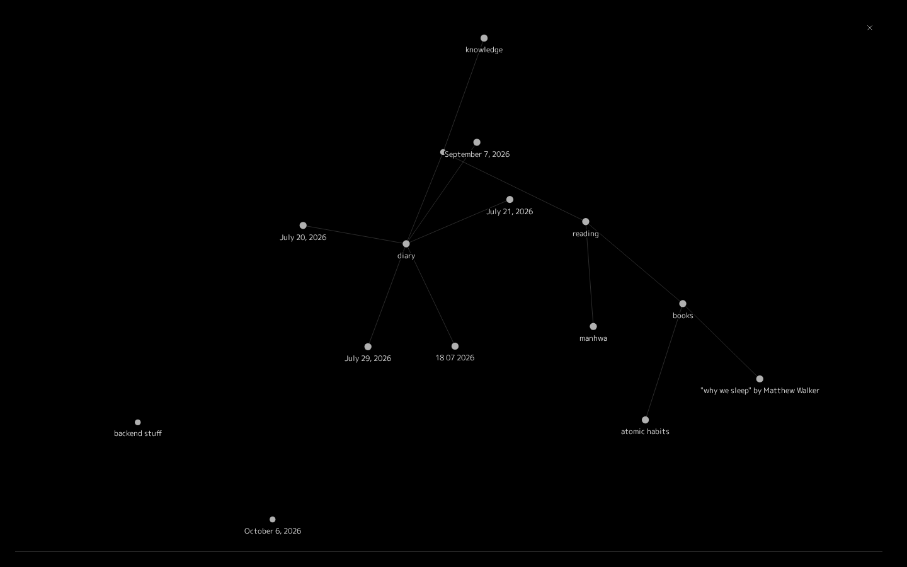
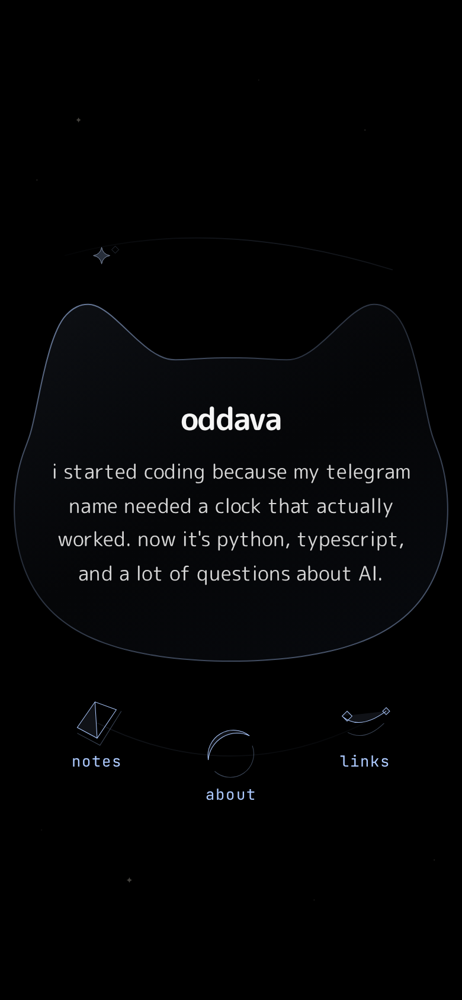

# oddava.me

Hey, I'm oddava. I got into code because my Telegram name needed a working clock.
This is the code behind my personal site, [oddava.me](https://oddava.me).
It's a small corner of the internet with a homepage, a notes garden, and an admin studio I use
to write.

<p align="center">
  
</p>

## What's here

- **Homepage**: a cat-shaped card with a little orbit of links around it. It plays a short
  intro the first time it loads.
- **Notes garden**: notes with folders, tags, backlinks, search, and an interactive graph that
  shows how everything connects.
- **Studio**: a private editor at `/admin/studio`. I type and it autosaves to the live store,
  so a note is up a second later. No commit and no deploy.
- **Now playing**: a widget that shows what I'm listening to (Spotify + Lanyard).
- **Guestbook**: signed, rate limited, and moderated.

## Screenshots

| Home                               | Notes                              |
| ---------------------------------- | ---------------------------------- |
|    |  |
| **About**                          | **Graph**                          |
|  |  |

<p align="center">
  
  &nbsp;
  
</p>

## Stack

- [Astro](https://astro.build) with a few [Preact](https://preactjs.com) islands
- Runs on Cloudflare Workers
- Redis for content (Upstash in production, a local container in dev)
- Tiptap for the editor, d3-force for the graph
- Vitest and Playwright for tests

## How notes work

There's no content folder compiled at build time. Notes live in a virtual filesystem in Redis,
and pages read from it on each request. A note's path in the store is its identity, so moving
a note in Studio changes its URL. `src/lib/garden` builds the rest: hierarchy, backlinks, tags,
search, and the graph.

`src/content/notes` is only a backup. `pnpm notes:export` dumps Redis into it so changes show
up in git, and `pnpm notes:migrate` pushes it back if I ever need to restore.

## Running it locally

You'll need Node 22.12+, pnpm 10, and Docker (for Redis).

```bash
pnpm install
cp .env.example .env      # fill in the values you need
docker compose up -d      # local Redis, ephemeral by design
pnpm notes:migrate        # seed Redis from src/content/notes
pnpm dev
```

Other useful scripts:

```bash
pnpm build          # production build
pnpm preview        # preview the build
pnpm test           # unit tests
pnpm test:browser   # Playwright tests
pnpm verify         # format, type check, tests, and build
pnpm deploy         # build and ship with wrangler
```

Integrations like Spotify only turn on when their env vars are set. In production the secrets
live in Cloudflare (`wrangler secret put`). There's no form in the admin panel for them.

## Project layout

```
src/pages          routes and API endpoints
src/lib/server     admin, content, guestbook, integrations, now-playing
src/lib/garden     hierarchy, backlinks, tags, search, graph layout
src/components     Astro components and Preact islands
scripts            notes export/migrate, Spotify token helper, build checks
```

Routes import a domain's barrel, not its internals. Underneath sits `core` (env, HTTP, signing,
rate limiting, Redis primitives). Everything imports it and it imports nothing back.

---

Thanks for stopping by. If you want to say hi, the guestbook is open.
