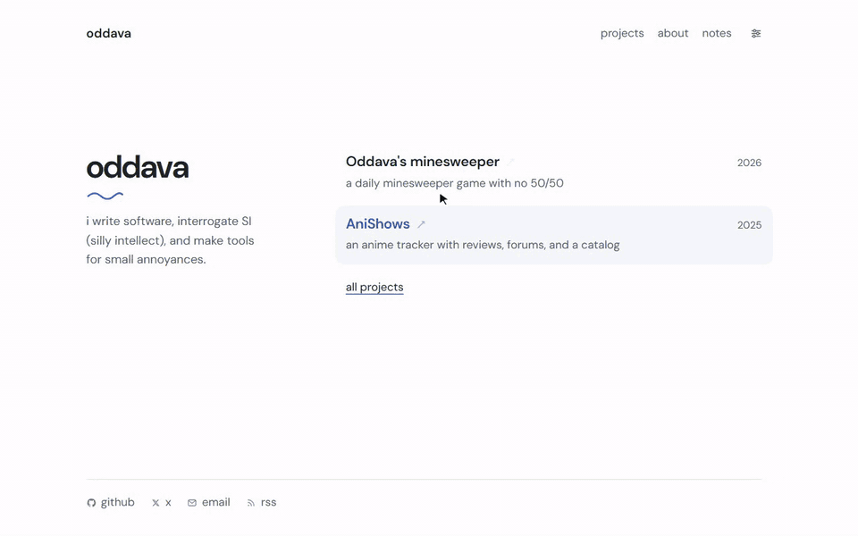
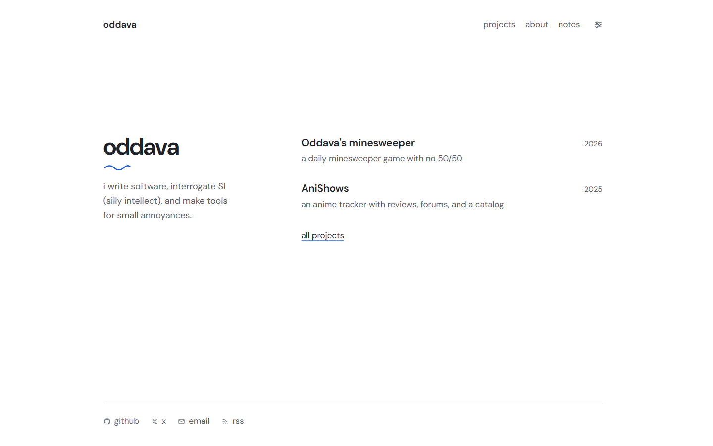
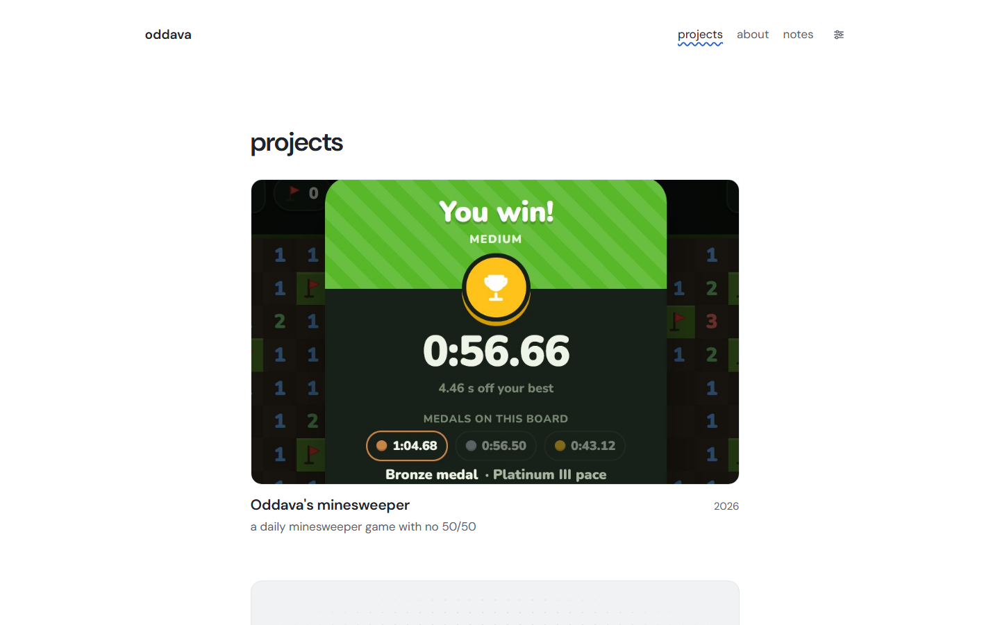
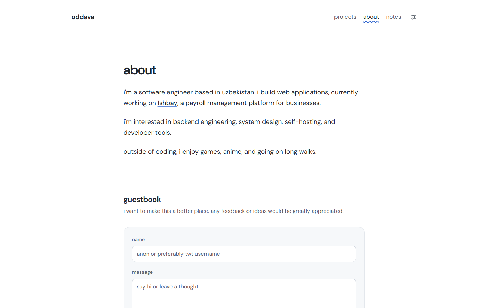
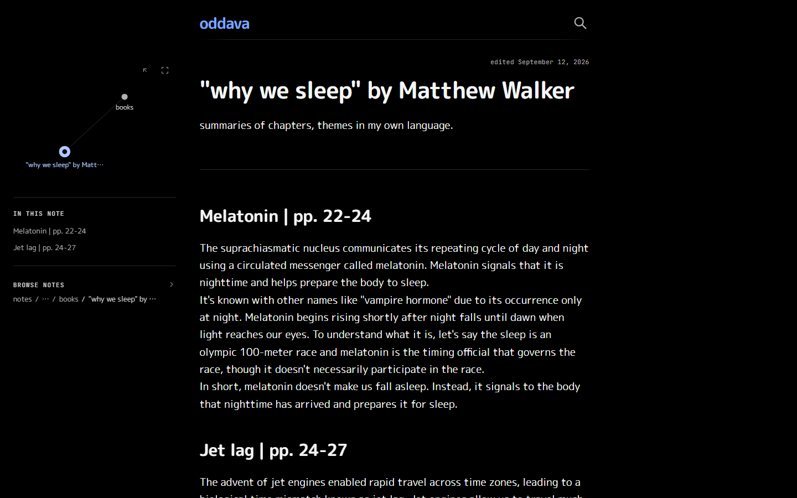
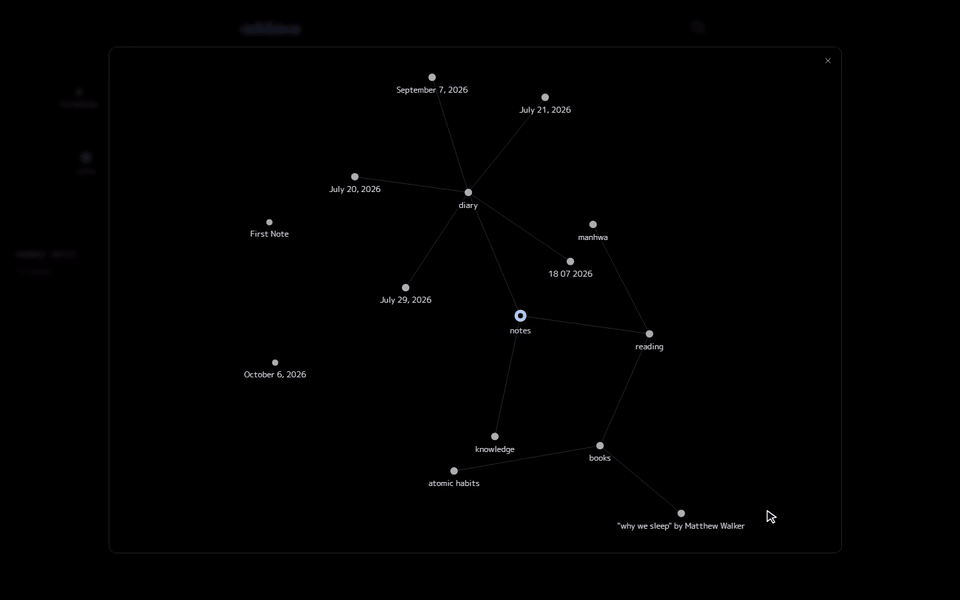
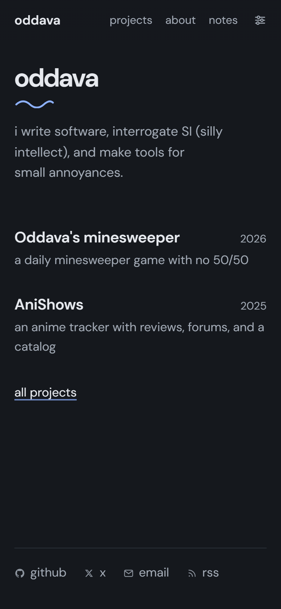

# oddava.me

Hey, I'm oddava. I got into code because my Telegram name needed a working clock.
This is the code behind my personal site, [oddava.me](https://oddava.me).
It's a small corner of the internet with a homepage, my projects, a notes garden, and an
admin studio I use to write.

<p align="center">
  
</p>

## What's here

- **Homepage**: my name, a one-line tagline, and my top projects. An appearance panel in the
  header picks the theme (system, light, or dark) and one of five ink colours, and remembers
  the choice.
- **Projects**: one column of picture cards. I add, edit, hide, and reorder them from the
  admin dashboard, and the page updates on the next load.
- **Notes garden**: lives on its own host, [notes.oddava.me](https://notes.oddava.me). Notes
  have folders, tags, backlinks, search, and an interactive graph that shows how everything
  connects.
- **Studio**: a private editor at `/admin/studio`. I type and it autosaves to the live store,
  so a note is up a second later. No commit and no deploy.
- **Admin dashboard**: guestbook moderation, projects, integrations, and a launcher for the
  other apps I self-host.
- **Now playing**: a widget that shows what I'm listening to (Spotify + Lanyard).
- **Guestbook**: on the about page. Signed, rate limited, and moderated.

## Screenshots

| Home                               | Projects                                 |
| ---------------------------------- | ---------------------------------------- |
|    |  |
| **About**                          | **Notes**                                |
|  |        |

<p align="center">
  
  &nbsp;
  
</p>

## Stack

- [Astro](https://astro.build) with a few [Preact](https://preactjs.com) islands
- Runs on Cloudflare Workers
- Redis for content (self-hosted on a VPS in production, a local container in
  dev)
- Tiptap for the editor, d3-force for the graph
- Vitest and Playwright for tests

## How notes work

There's no content folder compiled at build time. Notes live in a virtual filesystem in Redis,
and pages read from it on each request. A note's path in the store is its identity, so moving
a note in Studio changes its URL. `src/lib/garden` builds the rest: hierarchy, backlinks, tags,
search, and the graph.

`src/content/notes` is only a backup. `pnpm notes:export` dumps Redis into it so changes show
up in git, and `pnpm notes:migrate` pushes it back if I ever need to restore.

## Editing notes from somewhere else

Studio is the browser editor. `/api/notes` is a separate token API for clients
that are not a browser (an Obsidian plugin, a CLI). It is off until
`NOTES_API_TOKEN` is set, and the admin panel token is not accepted there.

```bash
pnpm exec wrangler secret put NOTES_API_TOKEN
```

Endpoints, curl examples, and how conflicts work are in
[docs/notes-api.md](docs/notes-api.md).

## Running it locally

You'll need Node 22.12+, pnpm 10, and Docker (for Redis).

```bash
pnpm install
cp .env.example .env      # fill in the values you need
docker compose up -d      # local Redis, ephemeral by design
pnpm notes:migrate        # seed Redis from src/content/notes
pnpm dev
```

The site is at http://localhost:4321 and the notes garden at http://notes.localhost:4321.

Other useful scripts:

```bash
pnpm build          # production build
pnpm preview        # preview the build
pnpm test           # unit tests
pnpm test:browser   # Playwright tests
pnpm verify         # format, type check, tests, and build
pnpm deploy         # build and ship with wrangler
```

Integrations like Spotify only turn on when their env vars are set. In production the secrets
live in Cloudflare (`wrangler secret put`). There's no form in the admin panel for them.

## Project layout

```
src/pages          routes and API endpoints
src/lib/server     admin, content, guestbook, integrations, now-playing, projects
src/lib/garden     hierarchy, backlinks, tags, search, graph layout
src/components     Astro components and Preact islands
scripts            notes export/migrate, Spotify token helper, build checks
```

Routes import a domain's barrel, not its internals. Underneath sits `core` (env, HTTP, signing,
rate limiting, Redis primitives). Everything imports it and it imports nothing back.

---

Thanks for stopping by. If you want to say hi, the guestbook is open.
